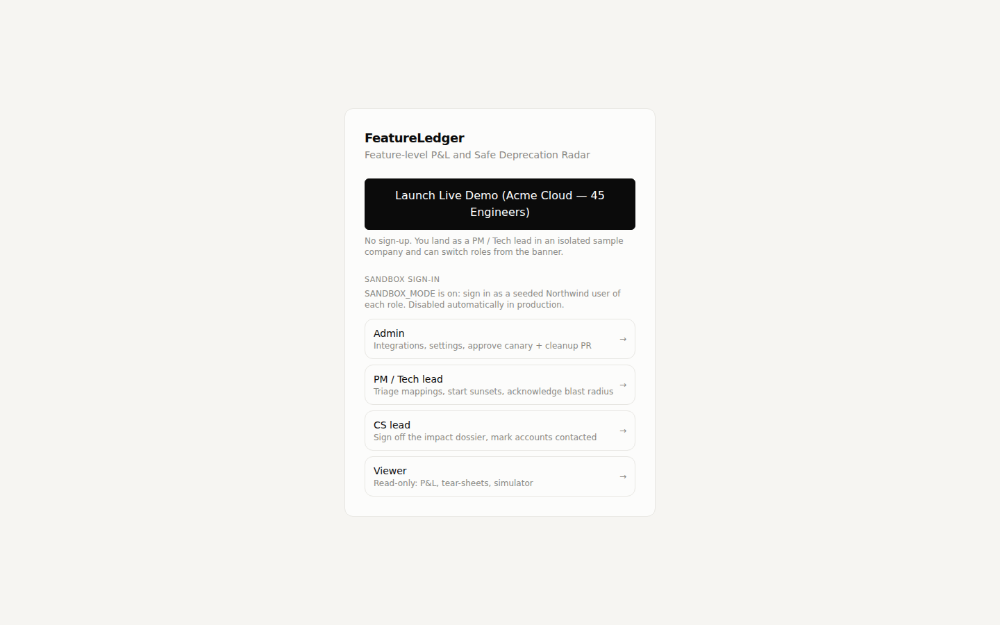
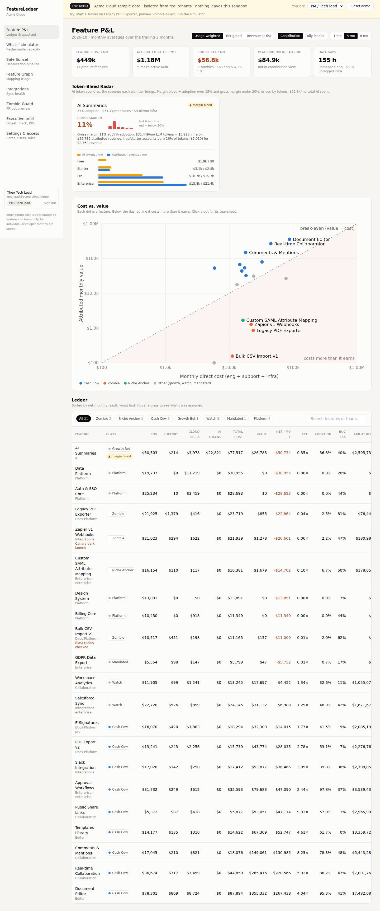
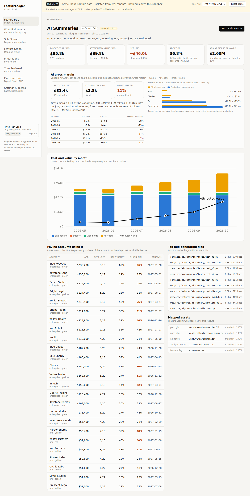
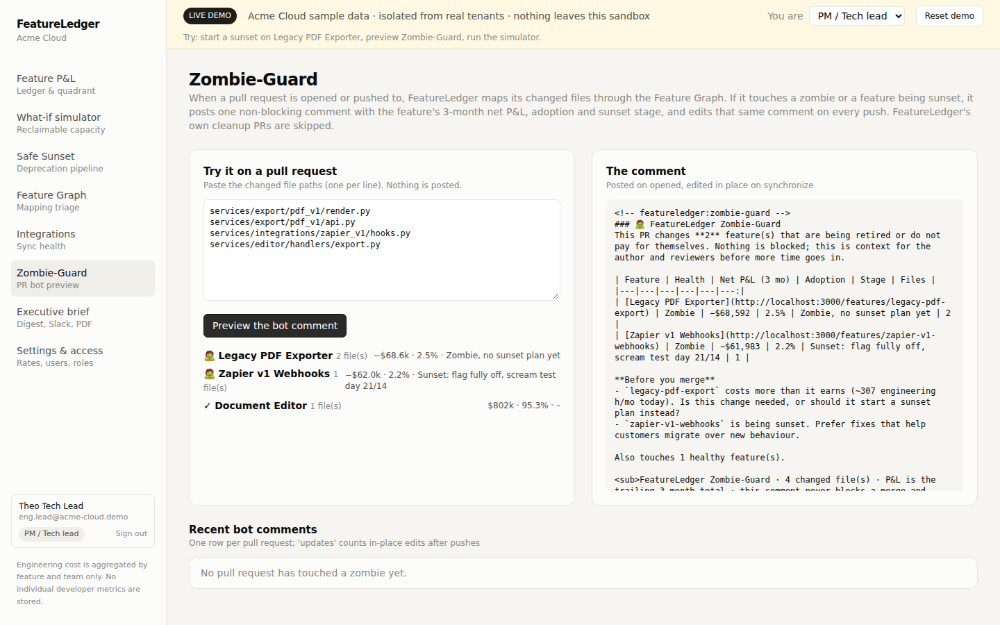
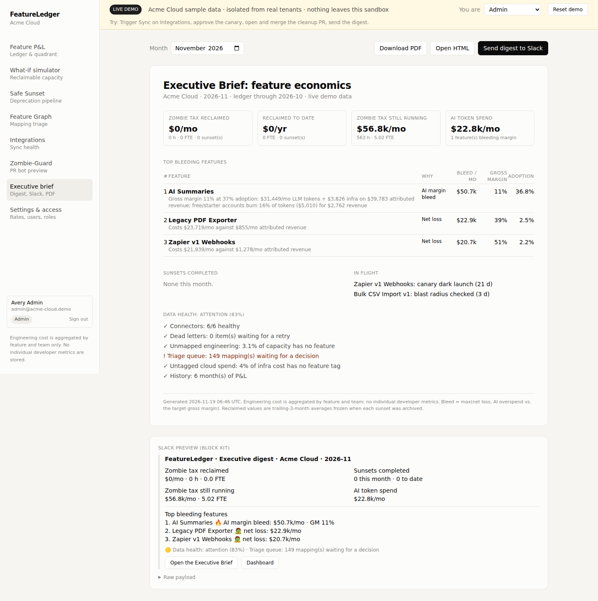

# FeatureLedger: Feature P&L & Safe Deprecation Radar

[](https://codespaces.new/yakov-ashgar27/FeatureLedger-Feature-P-L-Safe-Deprecation-Radar?quickstart=1)
[](https://github.com/yakov-ashgar27/FeatureLedger-Feature-P-L-Safe-Deprecation-Radar/actions/workflows/ci.yml)

**Run it with one click:** press *Open in GitHub Codespaces*. The whole stack builds and starts in the cloud, and the dashboard opens by itself in 3–6 minutes. Nothing to install. Press **Launch Live Demo (Acme Cloud — 45 Engineers)**: no sign-up, no setup.

## Live demo in 30 seconds



1. **Launch Live Demo.** You are a PM / Tech lead inside *Acme Cloud*, an isolated demo tenant (45 engineers, ~520
   accounts, 6 months of history). The yellow banner switches you to Viewer, CS lead or Admin in one click and
   resets the demo to its starting data.
2. **Feature P&L.** The ledger, the cost-vs-value quadrant, and the **Token-Bleed Radar**: *AI Summaries* is
   used by 37% of accounts, but its LLM tokens eat the revenue (gross margin 11% in the latest month), and
   free and starter accounts burn 16% of the tokens for almost no revenue.
3. **What-if simulator.** The three zombies are pre-selected: ~4.5 FTE and over $600k/yr of avoidable cost.
4. **Zombie-Guard.** Paste the files of a pull request and see the comment the bot would post on GitHub.
5. **Safe Sunset** (switch to *Admin*). *Zapier v1 Webhooks* has passed its scream test: *Approve cleanup PR*
   opens `acme/app#1001`, *Sandbox: merge the PR* archives it. Rolling back puts the flag fully on again.
6. **Integrations** (Admin): *Trigger Sync* runs the five sandbox connectors against vendor-shaped fixture APIs.
7. **Executive brief.** The month's reclaimed zombie tax (with the sunset you just finished), the top 3 bleeding
   features, data health; *Download PDF*, or *Send digest to Slack* (a dry run in the demo).

| | |
| --- | --- |
|  |  |
|  |  |

A reset re-seeds the tenant, then runs one in-process sandbox sync and Feature Graph pass, so the demo starts
at its steady state. After that, *Trigger Sync* changes nothing: CI checks every ledger number for an exact,
cent-for-cent match. The demo tenant only ever uses sandbox providers (flags, GitHub, PR comments, Slack), even on a deployment
configured with real credentials, and its sessions cannot reach any other tenant (Postgres RLS). Turn it off
with `DEMO_MODE=false` on a production deployment.

FeatureLedger gives every in-house product feature a monthly **profit & loss** statement. It joins
engineering effort (Git), support load, cloud and LLM spend, and tenant-level usage and ARR.
It then turns a "Zombie" verdict into a **guarded, reversible deletion workflow** that drives your feature
flag and opens the dead-code PR itself.

**מדריך הפעלה מלא בעברית, צעד אחר צעד:** [`docs/GETTING_STARTED.he.md`](docs/GETTING_STARTED.he.md)

```bash
cp .env.example .env
docker compose up --build        # migrate → seed → first sync → P&L (≈1 min after the build)
open http://localhost:3000       # dashboard → sign in as Admin / PM-Tech lead / CS lead / Viewer
open http://localhost:8000/docs  # API (OpenAPI; "Authorize" with `make token`)
```

The seed company is *Northwind Cloud*: 45 engineers in 7 teams, ~520 accounts, ~$14M ARR, 22 features and
6 months of history. Everything runs in **sandbox mode** by default: connectors read vendor-shaped fixture
APIs, flags and cleanup PRs go to sandbox providers, and sign-in is one click per role.

## Architecture (Phases 1–4)

```
        Stripe  Jira  PostHog  Zendesk  AWS CE   GitHub (PRs, push, PR merge)   LaunchDarkly / Statsig
           │      │      │        │       │         │                             ▲        │ evaluations
           ▼      ▼      ▼        ▼       ▼         ▼                             │ flag    ▼
   ┌───────────────── Phase 2: connectors (ARQ worker, every 15 min) ──────────┐  │ state  ┌──────────┐
   │ scrub → idempotent inbox → identity stitching → processors → dead letters │  │        │ eval     │
   └───────────────────────────────┬───────────────────────────────────────────┘  │        │ ingest   │
                                   ▼                                              │        │ (15 min) │
   ┌──── Phase 3: Feature Graph ─────────────────────────┐                        │        └────┬─────┘
   │ T1 features.yaml (push-synced) > T2 structural >   │                        │             │
   │ T3 semantic (pgvector, text never stored); human    │                        │             ▼
   │ decisions outrank all; triage below 0.80            │      ┌──── Phase 4: Safe Sunset execution ─────┐
   └──────────────────────────┬──────────────────────────┘      │ guarded state machine (pure)            │
                              ▼                                 │ + orchestrator: flag provider,          │
   ┌──── Phase 1: P&L engine (pure) ─────────────────────┐      │   cleanup-PR provider, merge webhook,   │
   │ effort calibration · attribution · classification   │─────▶│   hash-chained audit, fail-closed       │
   └──────────────────────────┬──────────────────────────┘      └───────────────────┬─────────────────────┘
                              ▼                                                     ▼
            PostgreSQL 16 + pgvector — Row-Level Security on every table (FORCE), app role without BYPASSRLS
                              ▲
   FastAPI ── Principal from session (cookie / bearer) ── RBAC matrix on every route ── tenant from the user record
                              ▲
   Next.js 15 dashboard ── /login (OIDC SSO or sandbox dev login) ── middleware ── role-aware controls
```

| Phase | What it adds | Where |
| --- | --- | --- |
| 1 | P&L engine, GitHub ingester, sunset state machine, dashboard, seed | `backend/app/core`, `ingest`, `web/` |
| 2 | Stripe, Jira, PostHog, Zendesk, AWS Cost Explorer; ARQ worker; Sync Health | `backend/app/connectors`, `worker.py` |
| 3 | features.yaml push sync, Tier 2 structural + Tier 3 semantic mapping, triage | `backend/app/graph` |
| 4 | Live flag control, automated cleanup PRs + merge webhook, OIDC SSO, RBAC | `backend/app/flags`, `cleanup`, `execution`, `auth` |
| 5 | AI gross margin + Token-Bleed Radar, Zombie-Guard PR bot, executive digest (Slack, PDF), live demo | `backend/app/core/pnl.py`, `guard`, `reports`, `demo.py` |

## Phase 5: differentiators

**AI gross margin & Token-Bleed Radar.** Variable LLM spend is now its own cost line, `c_ai_tokens`, separate
from fixed cloud infra (`c_infra`); `c_total` is unchanged. Every feature-month gets
`gross_margin_pct = (v_usage − c_ai_tokens − c_infra) / max(v_usage, 1)` and a per-tier split of token spend
(by usage events) next to the revenue each tier brings. **`margin_bleed`** fires when adoption is above 15% and
gross margin below 20%, and tokens (not infra) drive the cost. Both thresholds are org settings. The flag sits beside
the health class, so a Growth Bet can bleed margin too. It shows on the ledger (badge + radar) and the tear-sheet.

**Zombie-Guard.** On GitHub `pull_request` *opened / synchronize / reopened*, the changed files are resolved
through the Feature Graph (human > manifest > auto-confirmed). If a zombie, a feature in a live sunset plan,
or an archived feature is touched, one non-blocking comment shows its trailing 3-month net P&L, adoption and
sunset stage. On every push the same comment is edited in place, and only if the facts changed (a marker finds it
even after a database reset). FeatureLedger's own `sunset/*` cleanup PRs are skipped.
`GitHubCommentProvider` / `SandboxCommentProvider`; the *Zombie-Guard* page previews the comment for any set of paths.

**Executive digest.** On the 1st of every month (worker cron) and on demand
(`POST /api/v1/reports/executive-digest`):
- the zombie tax reclaimed this month (hours, FTE, $), frozen per sunset at archive time;
- completed sunsets and those still in flight;
- the top 3 bleeding features (net loss or AI overspend against the target margin);
- data-gap health.

It posts Block Kit to `SLACK_WEBHOOK_URL` (a dry run with a preview in `SANDBOX_MODE` and in the demo).
*Executive brief* in the dashboard is print-ready (*Download PDF*), and `/api/v1/reports/executive-brief.html`
is a self-contained HTML version.

**Live demo (`DEMO_MODE=true`).** The seed company is re-keyed into its own tenant (`acme-demo`) with
deterministic ids, so `POST /api/v1/demo/reset` restores exactly the same plans and users in a few seconds.
- *Launch* and *switch role* issue sessions only for that org.
- Reset refuses any org not flagged `is_demo`.
- The append-only audit log may be purged only for that demo org, and never by the application role.

## Phase 4: automated Safe Sunset execution & enterprise auth

**Live feature flags.** A `FeatureFlagProvider` interface with **LaunchDarkly** (semantic patch: turnFlagOn,
fallthrough, replaceTargets), **Statsig** (Console API gate rules; exposures via signed event webhook) and a
**sandbox** provider. The sunset orchestrator drives it:

| Plan step | Flag state | What happens |
| --- | --- | --- |
| `customer_outreach → canary_dark_launch` | `zero_usage_off` | Off for every account with 0 events in the last 90 days; on for the rest (targeted by account) |
| promote (same state) | `fully_off` | Off for everyone; the **scream test** clock starts |
| `canary_dark_launch → dead_code_pr_opened` | `fully_off` | Evaluations are re-pulled, then the guards: N quiet days, **0 'on' evaluations**, **0 tickets** → else `409 scream_test_running / flag_still_served / customer_screamed` |
| **rollback** (from canary or PR) | `fully_on` | Back to `customer_outreach`, `rollback_count + 1`, open cleanup PR closed, audit entry |

Evaluation counts are ingested every 15 minutes by the worker (and right before any guard check); a 'on'
evaluation or a ticket during the scream test also writes a one-time `scream_alert` into the audit log.
Every provider call happens inside the transition's transaction and **fails closed**: if LaunchDarkly or
GitHub refuses, the plan does not move.

**Automated dead-code PR.** When an admin approves a quiet canary, FeatureLedger uses the GitHub REST API
(Git Data API, one commit) to create branch `sunset/<feature_key>`, delete every file the manifest attributes
to the feature, remove its `features.yaml` entry (validated), and add `.featureledger/sunset/<key>.json`, a
structured cleanup patch for what a robot must not edit blindly (call sites, flag checks, routes, events).
The PR body carries the blast radius, the scream-test evidence and the hash-chained audit trail. A
`pull_request` *closed + merged* webhook on a `sunset/*` branch archives the plan and the feature and
recomputes the P&L. `SandboxGitHubProvider` builds the identical change without a network.

**Enterprise SSO.** OpenID Connect authorization code + PKCE for **Okta, Google Workspace and Auth0** (or any
compliant IdP): state + nonce in a signed short-lived cookie, id_token verified against the IdP's JWKS
(RS256/ES256), `iss`/`aud`/`azp`/`exp`/`nonce`/`email_verified` and an optional domain allowlist. IdP groups map
to roles (`OIDC_ROLE_MAP`); `BOOTSTRAP_ADMIN_EMAILS` seeds the first admins. With `SANDBOX_MODE=true` the
login page also offers a one-click **dev login** per role (never available outside sandbox mode).
Sessions are HS256 tokens in an HttpOnly, SameSite=Lax cookie; cookie writes also need an `X-FL-CSRF` header.

### RBAC matrix

Enforced by FastAPI on every route (`backend/app/auth/rbac.py`); the Next.js UI reads the same permissions
from `/api/v1/auth/me` and disables what your role cannot do. The tenant always comes from the user record;
Postgres RLS isolates tenants underneath.

| Capability | Viewer | PM / Tech lead | CS lead | Admin |
| --- | :-: | :-: | :-: | :-: |
| Read P&L, tear-sheets, simulator, sunset board, sync health | ✓ | ✓ | ✓ | ✓ |
| Confirm / reassign / reject mapping triage, run inference, recompute P&L | | ✓ | | ✓ |
| Initiate a sunset plan, compute + acknowledge blast radius, `→ blast_radius_checked` | | ✓ | | ✓ |
| Generate the impact dossier | | ✓ | ✓ | ✓ |
| Sign off the dossier, mark accounts contacted, `→ customer_outreach` | | | ✓ | ✓ |
| Approve `→ canary_dark_launch` and the fully-off promotion (flag changes) | | | | ✓ |
| Approve `→ dead_code_pr_opened` (opens the PR), manual archive | | | | ✓ |
| Roll back a canary (flag fully on) | | ✓ | ✓ | ✓ |
| Cancel a plan | | ✓ | | ✓ |
| Send the executive digest (Slack) | | ✓ | | ✓ |
| Integrations, imports, features.yaml apply, org settings (rates, thresholds), users & roles | | | | ✓ |

Webhooks (GitHub, Stripe, Jira, Zendesk, PostHog, Statsig) carry no user: the tenant is resolved from the
integration id and the vendor signature is verified before anything is read. `FL_API_TOKEN` is an optional
machine credential that acts as an admin service principal.

## Demo walkthrough (sandbox, ≈10 minutes)

1. `docker compose up --build`, open http://localhost:3000. You land on **/login**.
2. **Viewer**: browse the ledger and the quadrant. Every write control is disabled with the role it needs;
   *Settings & access* shows the permission matrix with your column highlighted. Sign out (bottom left).
3. **PM / Tech lead**: on **Feature Graph**, confirm a Tier 2 suggestion. Open the *Legacy PDF Exporter*
   tear-sheet → **Start safe sunset**. On the plan: *Compute blast radius* → *Acknowledge call sites* →
   *Confirm blast radius*. *Build account dossier*.
4. **CS lead**: open the plan, *Mark accounts contacted*, tick *CS sign-off*, *Start customer outreach*.
5. **Admin**: *Approve dark launch*. The flag card shows `zero_usage_off` and how many active accounts keep
   it. *Turn flag fully off*: the scream test starts. Advancing now returns **409 scream_test_running**.
6. Any non-viewer: **Roll back** → flag `fully_on`, plan back in outreach, *Rollbacks: 1*, audit entry.
7. **Admin** on *Zapier v1 Webhooks* (fully off since Oct 29, scream test passed): click
   *Sandbox: serve 'on' once* then *Approve cleanup PR* → **409 flag_still_served**. *Reset*, approve again:
   the PR `northwind/app#1001` on `sunset/zapier-v1-webhooks` opens, with its full body (blast radius, scream
   test, audit trail). *Sandbox: merge the PR* delivers the GitHub merge webhook → **Archived**.

The same walkthrough runs headless in CI: `make e2e` (or `python3 scripts/e2e_phase4.py`).

## Going live

With `SANDBOX_MODE=false` the API, the worker and the migrations **refuse to start** if `DEMO_MODE=true` or if
`SESSION_SECRET` is missing, blank or shorter than 32 characters. The error lists every problem at once.

| Piece | Set in `.env` |
| --- | --- |
| Connectors (Phase 2) | `SANDBOX_MODE=false` + each vendor's read-only credentials (scopes listed in `.env.example`) |
| SSO | `OIDC_PROVIDER`, `OIDC_ISSUER`, `OIDC_CLIENT_ID`, `OIDC_CLIENT_SECRET`, `OIDC_ROLE_MAP`, `BOOTSTRAP_ADMIN_EMAILS`, `SESSION_SECRET`, `APP_URL`; register `${APP_URL}/api/v1/auth/oidc/callback` at the IdP |
| Flags | `LAUNCHDARKLY_API_TOKEN` (+ project, environment, context kind) or `STATSIG_CONSOLE_API_KEY` (+ `STATSIG_WEBHOOK_SECRET`) |
| Cleanup PRs | `GITHUB_CLEANUP_TOKEN` (fine-grained: Contents + Pull requests read/write on one repo), `SUNSET_CLEANUP_REPO`; add the *Pull requests* event to the GitHub webhook |
| Zombie-Guard | the same GitHub webhook with *Pull requests* events; `GITHUB_TOKEN` (read) to list PR files; `GITHUB_COMMENT_TOKEN` (Pull requests: write) to comment |
| Executive digest | `SLACK_WEBHOOK_URL`, `SANDBOX_MODE=false` |
| Public demo | `DEMO_MODE=true` only on a deployment meant for visitors; `false` wherever real data lives |
| Damage signals | `SENTRY_CLIENT_SECRET` (Sentry internal integration → `/api/v1/webhooks/signals/sentry/<org>`) and/or `SIGNALS_WEBHOOK_SECRET` (gateway / logs → `/api/v1/webhooks/signals/generic/<org>`) |
| Behind a proxy | `TRUSTED_PROXY_HOPS` (1 = the dashboard, 2 = a load balancer in front of it); keep the API port private |
| LLM (optional) | `LLM_API_KEY` **and** `LLM_ALLOW_EXTERNAL=true`; without the second, ticket and PR text never leaves the deployment |

### What has been checked, and what has not

- **Tenant isolation**: catalog checks (forced RLS on every table and partition, an exact list of privileged
  functions) and an HTTP sweep of every authenticated route with another tenant's ids. See SPEC §13.6.
- **How sure each number is**: a confidence badge per feature and "Why this number?" on each tear-sheet.
  On the seed data every feature rates High: the seed is cleaner than real data will be.
- **Security**: revocable sessions, rate limits, security headers, explicit consent for external LLMs, dependency audit in CI.
- **Safe removal**: production errors and calls to retired routes block a sunset, next to tickets and flag evaluations.
- **Not yet**: an external penetration test, per-tenant webhook secrets, and the hosting work (managed secrets,
  backups, alerting, several API workers). The numbers are an allocation model, not accounting.

## Earlier phases in one paragraph each

**Archived features keep their history.** A sunset feature's monthly P&L rows survive every recompute, so the
before-and-after is visible on its tear-sheet. The ledger hides archived features by default: use
*Show archived* or `GET /api/v1/pnl?include_archived=true`. Summary KPIs always describe the live portfolio.

**Phase 1.** A pure engine computes each feature's monthly cost (calibrated engineering effort, support,
infra, LLM) and value (usage-weighted, tier-gated or critical-dependency attribution), classifies it
(Cash Cow, Growth Bet, Niche Anchor, Zombie, Mandated, Platform, Watch) and keeps the conservation
invariant: feature + overhead + unmapped + unattributed hours = real team capacity.

**Phase 2.** Stripe, Jira, PostHog, Zendesk and AWS Cost Explorer connectors share one protocol (backfill,
incremental, webhook) with allowlist scrubbing, an idempotent inbox, identity stitching, Redis token buckets,
backoff and dead letters after 5 attempts; the P&L recomputes after every sync that brings something new.

**Phase 3.** features.yaml syncs on push (invalid pushes are rejected with exact errors). Tier 2 maps
undeclared code from import edges, co-change and naming; Tier 3 matches tickets, issues and PR titles to
feature centroids in pgvector, with raw text held in memory only. Precedence: human > manifest >
auto-confirmed (≥ 0.80) > triage.

### What you'll see on the seed data

| Feature | Class | Why |
| --- | --- | --- |
| Legacy PDF Exporter | **Zombie** | 2.5% adoption and shrinking, ~75% bug tax, ≈ $24k/mo net loss |
| Zapier v1 Webhooks, Bulk CSV Import v1 | **Zombie** | Tiny usage, high maintenance |
| Custom SAML Attribute Mapping | **Niche Anchor** | <7% adoption, but Globex ($180k ARR, renews in Dec) uses it on 14 of 22 days |
| GDPR Data Export | **Mandated** | Regulatory: never a sunset candidate |
| AI Summaries | **Growth Bet** + **margin bleed** | Launched 2026-04, 37% adoption, ~$31k/mo of LLM tokens on ~$40k/mo revenue: 11% gross margin |

The What-if Simulator pre-selects the three zombies: roughly **4.5 FTE** (about 510 engineering hours a month)
and **over $600k/yr** of avoidable cost, against ~$115k of expected ARR loss across 31 accounts.

## Repository layout

```
db/migrations/           PostgreSQL DDL: partitions, RLS, hash-chained audit log, pgvector, Phase 4 auth/flags/PRs
backend/app/core/        pure P&L engine: effort, attribution, pnl, manifest, sunset state machine, simulate
backend/app/ingest/      GitHub ingester + allowlist scrubber (no author identity, no source code)
backend/app/connectors/  Phase 2: Stripe, Jira, PostHog, Zendesk, AWS CE + sandbox APIs, runner, processors
backend/app/graph/       Phase 3: precedence, Tier 2 structural, Tier 3 semantic (pgvector), manifest push sync
backend/app/auth/        Phase 4: RBAC matrix, sessions, OIDC (PKCE, JWKS), FastAPI dependencies
backend/app/flags/       Phase 4: FeatureFlagProvider: LaunchDarkly, Statsig, sandbox
backend/app/cleanup/     Phase 4: cleanup change builder + GitHub / sandbox PR providers
backend/app/execution/   Phase 4: sunset orchestrator (flags, PRs, merge webhook, scream monitor)
backend/app/guard/       Phase 5: Zombie-Guard (Feature Graph lookup, comment rendering, GitHub / sandbox comments)
backend/app/reports/     Phase 5: executive digest, Slack Block Kit, print-ready brief
backend/app/demo.py      Phase 5: live demo tenant (re-keyed seed, guarded reset)
backend/app/worker.py    ARQ worker: 15-minute syncs, flag evaluations, hourly graph, triggers
backend/app/api/         FastAPI routes
backend/tests/           unit tests + an HTTP integration suite (FL_INTEGRATION=1) run by CI on real Postgres
web/                     Next.js 15: login, ledger, tear-sheet, simulator, sunset board, triage, sync health, settings
scripts/e2e_phase4.py    the Phase 4 walkthrough as an executable check
scripts/e2e_phase5.py    the live-demo walkthrough (launch, roles, isolation, Trigger Sync, radar, guard, digest)
docs/SPEC.md             formulas, state machine, API, design decisions
```

## Development

```bash
make test                         # backend unit tests, no database required
make token                        # an admin token (sandbox dev login, or FL_API_TOKEN)
cd backend && python -m app.migrate   # migrate/seed against ADMIN_DATABASE_URL
cd web && npm install && npm run dev  # dashboard on :3000 (API_URL defaults to localhost:8000)
```

CI (`.github/workflows/ci.yml`) runs three jobs:
- **backend:** unit tests; migrations on pgvector Postgres; the RLS check; the Phase 4 and 5 HTTP suites (four roles,
  a second tenant, the demo tenant).
- **web:** typecheck and build.
- **e2e:**
  - `docker compose up` and the sandbox syncs;
  - the Phase 3 checks and the signed-in page renders;
  - the Phase 4 and Phase 5 walkthroughs, including Trigger Sync in the demo leaving the ledger unchanged;
  - README screenshots.

### Use your own data

1. Describe your teams and features in `features.yaml`. To start from a draft of your own code:
   `make draft-manifest REPO=../your-repo` writes `features.draft.yaml` (read-only; nothing leaves your machine).
2. In `.env`, set `SEED_ON_START=false`, `DEFAULT_ORG_SLUG`, `ORG_NAME`, and either SSO or `FL_API_TOKEN`.
3. Run `docker compose down -v && docker compose up --build -d`.
4. Import CSVs from `templates/`: `make import KIND=accounts FILE=accounts.csv PERIOD=2026-10`. Do the same for `usage`, `tickets` and `costs`, then run `make pnl`.

Until accounts and usage are imported, every feature is classified **Watch**: cost alone never makes a Zombie.

## Principles

- **No surveillance.** No author, reviewer or assignee is stored anywhere. Teams under 3 people are rolled up.
  Cleanup PR bodies name roles, never people.
- **Conservation.** Feature + overhead + unmapped + unattributed hours equal real team capacity, every month.
- **Two lenses.** Additive value (sums to MRR) for the ledger, and counterfactual revenue-at-risk to guard deletions.
- **Reversible by default.** No code is deleted until a fully-off scream test has been quiet for N days, and
  the flag stays the rollback lever until the PR merges.
- **Least privilege.** Read-only ingest tokens; the cleanup token is separate and scoped to one repo;
  approvals that change production (flags, PRs) are admin-only and audited.

See [`docs/SPEC.md`](docs/SPEC.md) for every formula and threshold.
