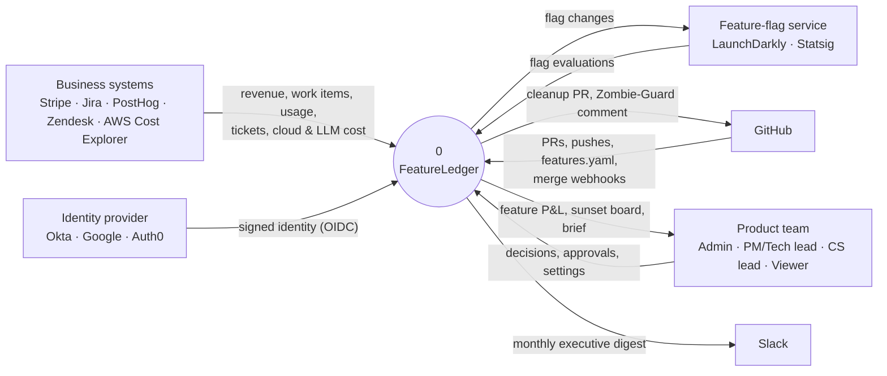
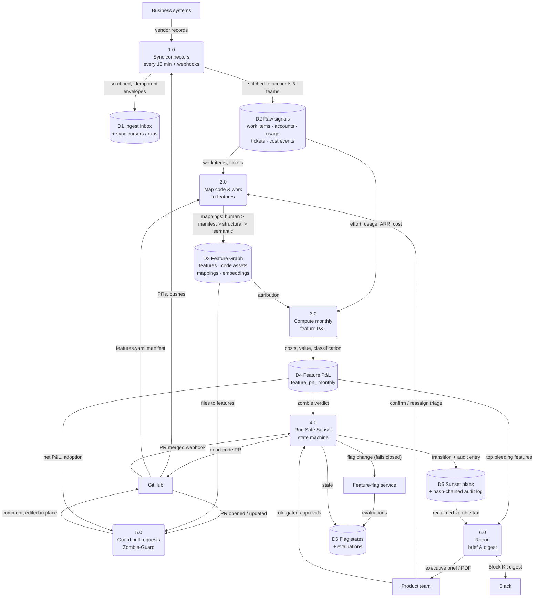
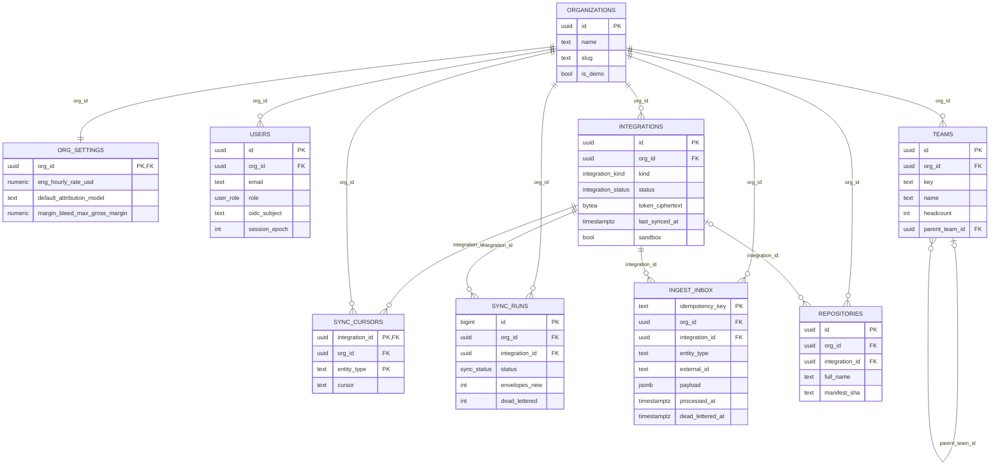
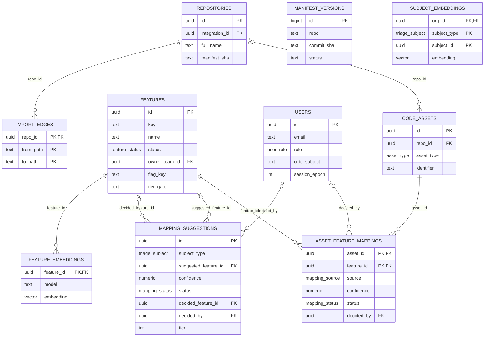
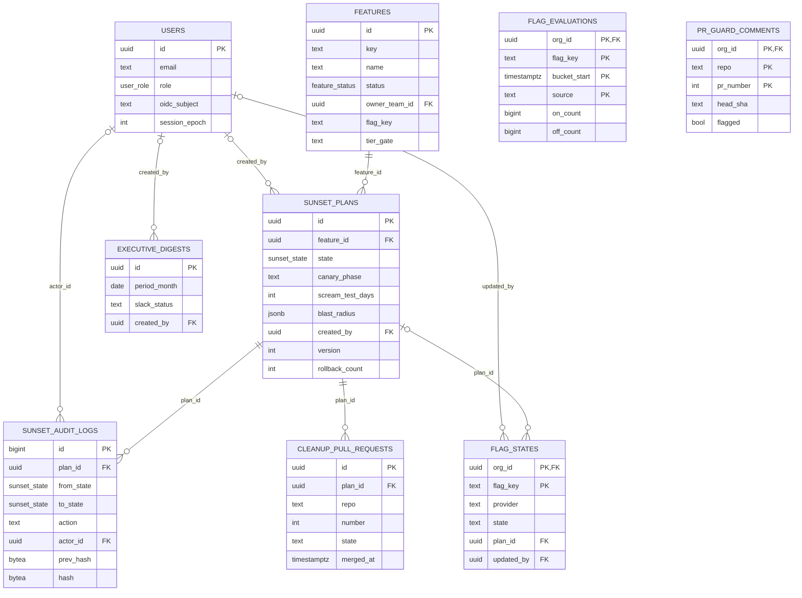

# FeatureLedger: Data Flow & Data Model

Drawn from the code: the 11 SQL migrations in [`db/migrations/`](../db/migrations/) (the ERD was generated from them, so table and column names match exactly) and the pipeline described in the [README](../README.md#architecture-phases-14). GitHub renders the diagrams directly.

**Contents:** [DFD Level 0](#dfd-level-0-context-diagram) · [DFD Level 1](#dfd-level-1) · [ERD overview](#erd-overview-all-37-tables-by-domain) · [Tenancy & ingestion](#1-tenancy-access--ingestion) · [Cost & value (P&L)](#2-cost--value-the-pl-inputs-and-output) · [Feature Graph](#3-feature-graph-which-code-belongs-to-which-feature) · [Safe Sunset](#4-safe-sunset-flags-cleanup-prs-and-reports)

**DFD notation:** rectangles are external entities, numbered rounded boxes are processes, cylinders are data stores.

## DFD Level 0: context diagram

## DFD Level 1

## ERD overview: all 37 tables by domain

Every table carries `org_id` and is isolated per tenant by **PostgreSQL Row-Level Security** (`FORCE`d, app role without `BYPASSRLS`). To keep the diagrams readable, the `org_id → organizations` link is drawn only in the tenancy view. In the detailed views, dotted lines are logical references on partitioned tables (`usage_signals`, `cost_events`), which have no database-level foreign key.

```mermaid
flowchart TB
    subgraph T["1 · Tenancy & ingestion"]
        direction TB
        organizations --- org_settings
        organizations --- users
        organizations --- teams
        organizations --- integrations
        integrations --- sync_cursors
        integrations --- sync_runs
        integrations --- ingest_inbox
        integrations --- repositories
    end
    subgraph P["2 · Cost & value (P&L)"]
        direction TB
        work_items --- work_item_allocations
        accounts --- account_identities
        accounts --- account_snapshots
        accounts --- account_activity_monthly
        accounts --- usage_signals
        accounts --- support_tickets
        accounts --- account_dependencies
        cost_events
        damage_signals
        eng_capacity_monthly
        feature_pnl_monthly
    end
    subgraph G["3 · Feature Graph"]
        direction TB
        features --- code_assets_map["asset_feature_mappings"]
        code_assets --- code_assets_map
        import_edges
        manifest_versions
        mapping_suggestions
        feature_embeddings
        subject_embeddings
    end
    subgraph S["4 · Safe Sunset & reports"]
        direction TB
        sunset_plans --- sunset_audit_logs
        sunset_plans --- flag_states
        sunset_plans --- cleanup_pull_requests
        flag_evaluations
        pr_guard_comments
        executive_digests
    end
    repositories --> code_assets
    teams --> work_items
    features --> work_item_allocations
    features --> feature_pnl_monthly
    features --> usage_signals
    features --> sunset_plans
```

Each box is a table; lines inside a domain are foreign keys, arrows between domains are the main cross-domain links. The detailed ERDs below show primary keys, foreign keys and the main business columns of each table (not every column).

### 1. Tenancy, access & ingestion

### 2. Cost & value: the P&L inputs and output

```mermaid
erDiagram
    TEAMS |o--o{ FEATURES : "owner_team_id"
    TEAMS |o--o{ TEAMS : "parent_team_id"
    TEAMS |o--o{ WORK_ITEMS : "team_id"
    WORK_ITEMS ||--o{ WORK_ITEM_ALLOCATIONS : "work_item_id"
    FEATURES ||--o{ WORK_ITEM_ALLOCATIONS : "feature_id"
    TEAMS ||--o{ ENG_CAPACITY_MONTHLY : "team_id"
    ACCOUNTS ||--o{ ACCOUNT_IDENTITIES : "account_id"
    ACCOUNTS ||--o{ ACCOUNT_SNAPSHOTS : "account_id"
    ACCOUNTS ||--o{ ACCOUNT_ACTIVITY_MONTHLY : "account_id"
    ACCOUNTS |o--o{ SUPPORT_TICKETS : "account_id"
    FEATURES |o--o{ SUPPORT_TICKETS : "feature_id"
    FEATURES |o--o{ DAMAGE_SIGNALS : "feature_id"
    FEATURES ||--o{ ACCOUNT_DEPENDENCIES : "feature_id"
    ACCOUNTS ||--o{ ACCOUNT_DEPENDENCIES : "account_id"
    FEATURES ||--o{ FEATURE_PNL_MONTHLY : "feature_id"
    FEATURES ||..o{ USAGE_SIGNALS : "feature_id (logical)"
    ACCOUNTS ||..o{ USAGE_SIGNALS : "account_id (logical)"
    FEATURES ||..o{ COST_EVENTS : "feature_id (logical, NULL = untagged)"
    FEATURES {
        uuid id PK
        text key
        text name
        feature_status status
        uuid owner_team_id FK
        text flag_key
        text tier_gate
    }
    TEAMS {
        uuid id PK
        text key
        text name
        int headcount
        uuid parent_team_id FK
    }
    WORK_ITEMS {
        uuid id PK
        work_source source
        work_kind kind
        uuid team_id FK
        uuid repo_id FK
        date period_month
        numeric raw_effort_hours
    }
    WORK_ITEM_ALLOCATIONS {
        uuid work_item_id PK,FK
        uuid feature_id PK,FK
        numeric share
        mapping_source source
    }
    ENG_CAPACITY_MONTHLY {
        uuid org_id PK,FK
        uuid team_id PK,FK
        date period_month PK
        numeric capacity_hours
        numeric calibration_factor
    }
    ACCOUNTS {
        uuid id PK
        text name
        text plan_tier
        numeric arr_usd
        date renewal_date
    }
    ACCOUNT_IDENTITIES {
        uuid account_id FK
        uuid org_id PK,FK
        integration_kind system PK
        text external_id PK
    }
    ACCOUNT_SNAPSHOTS {
        uuid org_id PK,FK
        uuid account_id PK,FK
        date period_month PK
        numeric arr_usd
        text plan_tier
    }
    ACCOUNT_ACTIVITY_MONTHLY {
        uuid org_id PK,FK
        date period_month PK
        uuid account_id PK,FK
        int active_days
    }
    USAGE_SIGNALS {
        uuid org_id PK
        date period_month PK
        uuid account_id PK
        uuid feature_id PK
        bigint events
        int active_users
    }
    SUPPORT_TICKETS {
        uuid id PK
        uuid account_id FK
        uuid feature_id FK
        numeric mapping_confidence
        text priority
        int handle_minutes
    }
    COST_EVENTS {
        bigint id PK
        uuid org_id PK
        date period_month PK
        cost_type cost_type
        numeric amount_usd
        text unit
    }
    DAMAGE_SIGNALS {
        uuid id PK
        uuid feature_id FK
        text kind
        int occurrences
    }
    ACCOUNT_DEPENDENCIES {
        uuid org_id PK,FK
        uuid feature_id PK,FK
        uuid account_id PK,FK
        date period_month PK
        numeric dependency_score
        numeric churn_risk
        numeric attributed_mrr
    }
    FEATURE_PNL_MONTHLY {
        uuid org_id PK,FK
        uuid feature_id PK,FK
        date period_month PK
        numeric c_eng
        numeric c_support
        numeric c_infra
        numeric c_total
        numeric v_usage
        numeric v_tier
        numeric revenue_at_risk_arr
        feature_class classification
        numeric c_ai_tokens
        numeric gross_margin_pct
        bool margin_bleed
    }
```

`feature_pnl_monthly` is the computed result: one row per feature per month, with cost lines (engineering, support, infra, AI tokens), value lines (usage, tier) and the classification (e.g. Zombie, Growth Bet).

### 3. Feature Graph: which code belongs to which feature

### 4. Safe Sunset: flags, cleanup PRs and reports

`sunset_audit_logs` is append-only and hash-chained (`prev_hash` → `hash`), so any edit to history is detectable.
