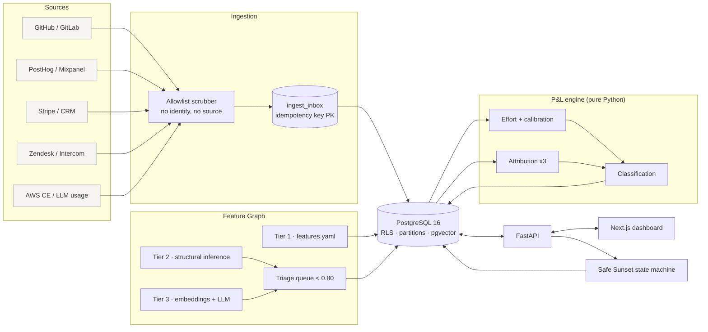
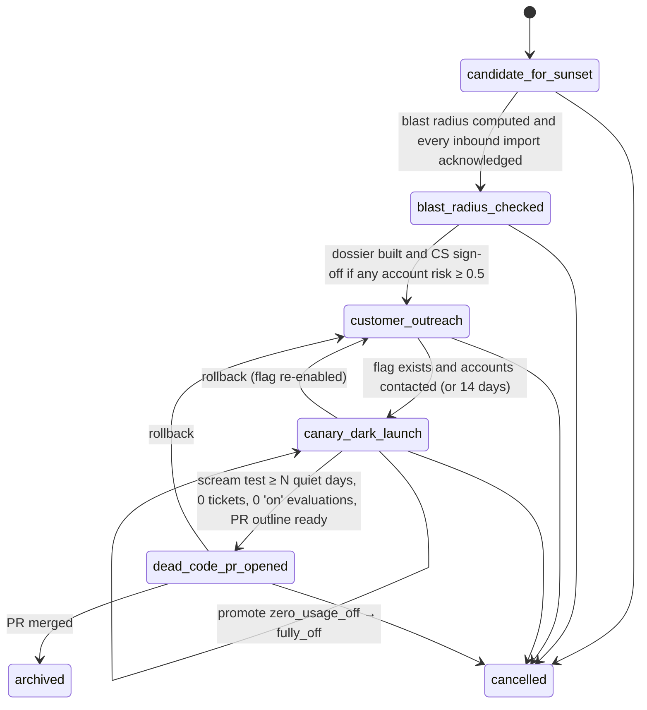

# FeatureLedger: specification (as built, Phases 1–3)

This document describes what the code in this repository does, and why. Every formula below has
a unit test in `backend/tests/`, and the section numbers are referenced from code comments.

## 1. Architecture



| Decision | Choice | Why |
| --- | --- | --- |
| Engine isolation | `app/core/*` has no I/O; the DB job and the seed both build a `Dataset` | Every formula is testable and replayable. Model changes are re-run over history, not migrated. |
| Tenancy | Postgres RLS with `FORCE`, API connects as a `NOBYPASSRLS` role, `set_config('app.org_id', …, true)` per transaction | A forgotten `WHERE org_id` returns nothing instead of leaking. Pooled connections can't carry a tenant across requests. |
| Time series | `usage_signals` and `cost_events` range-partitioned by month | Monthly is the P&L grain; dropping or detaching old partitions is cheap. |
| Auditability | `sunset_audit_logs` is append-only (trigger + revoked grants) and SHA-256 hash-chained | Deletion decisions are high-stakes. The chain makes after-the-fact edits detectable. |
| Privacy | Allowlist scrubber; `work_items` has no author column; teams under 3 people roll up | Engineers adopt a tool that cannot rank them. Enforced by the schema, not by policy. |

## 2. Entity resolution (the Feature Graph)

1. **Tier 1, manifest** (`features.yaml`, parsed by `core/manifest.py`). It declares path globs (`**` crosses directories), API route prefixes, analytics events and aliases, flag keys, Jira labels/epics, tier gate, `regulatory`, `shared_overhead` and `allocation_rule`, and `replaced_by`.
   - When several globs match a file, the most specific wins: longest literal prefix, then most literal characters.
   - The same glob, event or flag claimed by two features is a validation error.
   - Lockfiles, `vendor/`, snapshots and generated files are ignored for churn.
2. **PR allocation.** A PR's effort splits across features by churn on their files (`additions + 0.5·deletions`). Churn on unmapped files leaves the shares summing below 1, and the remainder is booked as `unmapped`. A PR touching more than 50 features or more than 5,000 lines is `sweeping` and is booked to platform overhead.
3. **Tiers 2 and 3** write `mapping_suggestions` with a confidence. Anything below `org_settings.mapping_auto_confirm` (0.80) waits in the triage UI. A human confirmation creates a `human` mapping, which outranks machine mappings.
4. **Shared overhead.** Features flagged `shared_overhead` are reported as the Platform line. In the fully-loaded view their cost is allocated by `proportional_usage`, `proportional_cost` or `fixed_weights`. Sunset savings never include it.

## 3. Engineering cost (`core/effort.py`)

```
H_raw(pr) = (0.5 + 1.2·ln(1 + churn/20))
          × (1 + 0.15·min(review_rounds, 6))        changes-requested cycles
          × (1 + 0.05·min(files − 1, 20))
          × type_mult                                feature 1.0 · chore 0.8 · bug 1.3 · revert 1.5
                                                     hotfix/incident 2.0 · P0 hotfix/incident 3.0
          + incident_response_hours                  aggregate, team level
```

Example: a 2-line typo comes to 0.49 h, a 120-line bug fix with one review round to 4.87 h, and a 300-line P0 hotfix plus 12 h of incident response to 30.66 h (`test_effort.py`).

**Calibration: relative effort, absolute budget.** For each team and month:

```
capacity = headcount × hours_per_engineer_month (140) × allocatable_fraction (0.80)
k        = min(capacity / Σ H_raw, clamp 4.0)
hours    = k × H_raw
```

The invariant is `feature + overhead + unmapped + unattributed = capacity` for every team and month, and it is tested on the full seed. `C_eng = hours × eng_hourly_rate` (default $95).

## 4. Value, P&L and classification

### 4.1 Engagement

`e(a,f) = active_days × ln(1 + active_users)`. It uses active days, not raw events, so instrumentation granularity can't skew it.

### 4.2 Attribution models (`core/attribution.py`)

| Model | Formula | Sums to MRR? | Used for |
| --- | --- | --- | --- |
| Usage-weighted | `Σ_a MRR(a) · e(a,f) / Σ_g e(a,g)` | yes | default ledger |
| Tier-gated | uplift share `u_T` (enterprise 35%, pro 20%) of the account's MRR goes to the gated features it used; the rest is usage-weighted | yes | pricing and packaging questions |
| Critical dependency | `RaR(f) = Σ_a ARR(a) · risk(a,f)`, shown as `RaR/12` | **no** (counterfactual) | guarding sunset decisions |

`risk(a,f)` is 0 if `c < 0.10`. Otherwise it is `min(1, c/0.40) × proximity × health`, where:

- `c` is the share of the account's active days that touch the feature
- proximity is 1.0 if renewal is within 90 days, 0.8 within 180 days, otherwise 0.6
- health is red 1.0, yellow 0.9, green 0.7

An **anchor account** has `c ≥ 0.40` and ARR ≥ $100k.

### 4.3 P&L

```
C_total = C_eng + C_support + C_infra           C_support = Σ handle_min/60 × $45
Net_ROI = V − C_total                           Efficiency = V / max(C_total, 1)
```

Adoption is active accounts divided by **eligible** paying accounts. An Enterprise-only feature is measured against Enterprise accounts only.

### 4.4 Classification

Rules use a trailing 3-month window and run in this order; the first match wins:

1. `platform`: the feature is shared overhead.
2. `mandated`: the feature is regulatory (GDPR export, for example). It can never be sunset.
3. `niche_anchor`: adoption is under 10% and at least one anchor account exists. *Do not kill blindly.*
4. `zombie`: needs at least 2 months of data, and all of these hold:
   - adoption is under 5%
   - the 3-month net is negative
   - the active-account trend is ≤ 0
   - bug tax is ≥ 40% or the average cost is ≥ $2,000 a month
5. `growth_bet`: the feature is under 9 months old or adoption grows ≥ 10% month over month, and cost is ≥ value.
6. `cash_cow`: efficiency is ≥ 2×.
7. `watch`: none of the rules above matched.

### 4.5 Worked example: Legacy PDF Exporter, one month

| Item | Calculation | USD |
| --- | --- | --- |
| Engineering | 61 calibrated h × $95 | 5,795.00 |
| Support | 38 tickets × 0.75 h × $45 | 1,282.50 |
| Infra | tagged render workers | 410.00 |
| **C_total** | | **7,487.50** |
| Value (usage-weighted) | e.g. a $150k ARR account: $12,500 MRR × 3.30 / 164.8 = $250, plus 13 smaller accounts | 810.00 |
| **Net** | | **−6,677.50** |
| Efficiency | 810 / 7,487.50 | 0.108× |

## 5. What-if simulator (`core/simulate.py`)

The simulator works on averages over the window, for the selected features:

- **Reclaimed hours** = average eng hours × 0.9. The 10% is the migration tail.
- **Avoidable cost** = 0.9 × eng cost + support + infra.
- **Expected ARR loss** = `Σ_accounts ARR × max_f risk × (1 − migration_success)`. Each account counts once.
- **Net annual impact** = 12 × avoidable cost − expected loss − one-off migration cost.

## 6. Safe Sunset (`core/sunset.py`)



- Regulatory and shared-overhead features are refused at creation and at every transition.
- Transitions use optimistic concurrency (`expected_version`).
- Each step produces evidence (`core/sunset_artifacts.py`):
  - **Blast radius:** reverse import edges into the feature's globs, grouped by owning feature.
  - **Impact dossier:** paying accounts from the last 90 days, ARR-sorted, with a drafted migration email that names the `replaced_by` feature.
  - **Cleanup PR outline:** files and tests to delete, call sites to edit, routes, flag checks, and the manifest entry.

## 7. API (FastAPI, `/docs` for OpenAPI)

| Method | Path | Purpose |
| --- | --- | --- |
| GET | `/api/v1/pnl?period&model&view&window` | Ledger and summary (zombie tax, data gaps) |
| GET | `/api/v1/features/{key}` | Tear-sheet: history, accounts, top bug files, mapped assets |
| POST | `/api/v1/simulate` | What-if for `feature_keys` |
| GET/POST | `/api/v1/sunset-plans` | List and create plans |
| GET | `/api/v1/sunset-plans/{id}` | Plan, evidence and audit chain |
| POST | `/api/v1/sunset-plans/{id}/evidence/{blast_radius\|impact_dossier\|cleanup_pr}` | Generate evidence |
| POST | `/api/v1/sunset-plans/{id}/acknowledge` | Acknowledge call sites or contacted accounts |
| POST | `/api/v1/sunset-plans/{id}/advance` · `/rollback` · `/cancel` | Guarded transitions (409 with `code` on guard failure) |
| GET/POST | `/api/v1/triage`, `/api/v1/triage/{id}` | Feature Graph triage queue |
| POST | `/api/v1/manifest/validate` | Validate a `features.yaml` body |
| POST | `/api/v1/manifest/apply` | Sync `features.yaml` (teams, features, Tier 1 mappings) into the database |
| POST | `/api/v1/import/{accounts\|usage\|tickets\|costs}?period=YYYY-MM` | CSV import (templates in `/templates`), all-or-nothing with line-numbered errors |
| POST | `/api/v1/jobs/compute-pnl` | Recompute every month |
| POST | `/api/v1/integrations/github/sync` | Ingest a repository (needs `GITHUB_TOKEN`) |
| GET | `/api/v1/periods`, `/teams`, `/integrations`, `/settings`, `/health` | Supporting reads |

## 8. Dashboard colour

The scatter uses categorical slots 1–3 (blue `#2a78d6`, orange `#eb6834`, aqua `#1baf7a`). That set passes the all-pairs CVD check (worst ΔE 9.2). Every other class folds to a neutral grey. Aqua sits below 3:1 contrast on the surface, so classes always carry a text label and the ledger table is the accessible view of the same data.

## 9. Edge cases handled

- Monorepo vs polyrepo: globs are repo-relative, and features may span `web/` and `services/`.
- Lockfile and generated churn is excluded. Sweeping refactors go to overhead.
- A quiet month can't inflate cost: calibration is clamped, and the remainder is `unattributed`.
- Enterprise-only features are measured against eligible accounts.
- Free-tier usage counts toward adoption and support cost, but contributes $0 value.
- Regulatory features are classified `mandated` and blocked from sunset.
- Untagged infra spend and unmapped engineering hours are surfaced as data-quality KPIs, never hidden.

## 10. Phase 2: live connectors

| Source | API | Streams (cursor) | What it feeds |
| --- | --- | --- | --- |
| Stripe | Customers, Subscriptions, Invoices, Events | list backfill (`starting_after`), then `/v1/events` (`created[gt]`) | accounts, ARR, tier, renewal, monthly ARR history |
| Jira | REST v3 `search/jql` | `issues` (`updated`, 1-minute overlap) | PR kind and priority via linked keys; label/epic ownership for unmapped PRs |
| PostHog | Groups API + Query API (HogQL) | `groups` (full refresh), `usage` (month) | `usage_signals`, `account_activity_monthly` |
| Zendesk | Organizations + incremental ticket export (`include=metric_sets`) | `organizations`, `tickets` (`after_cursor`) | `support_tickets`, handle time, triage of untagged tickets |
| AWS Cost Explorer | `GetCostAndUsage` by TAG `feature` × SERVICE | `costs` (month; restated months re-read) | `cost_events` (infra, LLM for Bedrock/SageMaker) |

**Contract.** `Connector.backfill(ctx, stream)` and `Connector.incremental(ctx, stream, cursor)` yield `Batch(envelopes, cursor)`. `handle_webhook` turns a verified webhook into envelopes, or into a sync trigger. The runner writes a batch's envelopes to `ingest_inbox` (primary key = sha256 idempotency key) and upserts the stream cursor **in the same transaction**.

**Scrubbing.** Allowlists per source (`connectors/scrub.py`). Assignees, reporters, requesters, emails (only the domain survives, for stitching), contact names, descriptions and comment threads never reach storage. The sandbox APIs include those fields on purpose, so every sandbox sync re-tests the scrubbers.

**Identity stitching** (`connectors/stitching.py`) tries, in order:
1. A recorded identity in `account_identities`.
2. For Stripe, the customer id itself (`accounts.external_ref`).
3. A unique email or web domain. Free-mail domains never match, and an ambiguous domain is not guessed.

Matches by domain are recorded as identities. Unmatched PostHog groups book their usage to the synthetic `__unresolved__` account, which is shown as a data gap.

**Processing** (`connectors/processors.py`) runs in bulk and in dependency order:
1. Stripe.
2. Stitching for Zendesk organizations and PostHog groups.
3. Jira.
4. Zendesk tickets.
5. PostHog months, then AWS months.

Stripe accounts and PostHog/AWS months are rebuilt from the latest version of every envelope, so replays and restatements converge. A normalization error fails one envelope; a SQL error rolls back that handler's savepoint. After 5 attempts an envelope is dead-lettered. The Sync Health view lists dead letters and can re-queue them.

**Worker.** ARQ on Redis:
- A cron job runs every 15 minutes, plus once at startup, and enqueues one `sync_org_job` per org with due integrations. Jobs are de-duplicated by `sync:<org>`.
- Each job syncs in dependency order, processes the inbox, and recomputes the P&L when anything new landed.
- Token buckets live in Redis (atomic Lua) and are shared across workers.
- Requests back off on 429 and 5xx, honoring `Retry-After` and `X-RateLimit-Reset`, with full-jitter exponential backoff and up to 6 attempts.

**Sandbox mode** (`SANDBOX_MODE=true`, the default). The seed loads only the organization, teams, features and PRs. The five connectors then fetch customers, usage, tickets, issues and costs from vendor-shaped fixture APIs built from the same seed. `tests/test_connectors_roundtrip.py` proves that the ledger produced this way equals the Phase 1 ledger for every feature and month.

**Webhooks.** `POST /api/v1/webhooks/{kind}/{integration_id}`, verified per vendor:

| Source | Verification |
| --- | --- |
| Stripe | `Stripe-Signature` (with a timestamp tolerance) |
| Zendesk | `X-Zendesk-Webhook-Signature` |
| Jira | `X-Hub-Signature` |
| PostHog | Shared secret |
| Sandbox | Shared secret `sandbox` |

**Sync Health API.**
- `GET /api/v1/integrations` returns health, cursors, inbox counts and recent runs for each integration.
- `POST /api/v1/integrations/{id}/sync` triggers a sync.
- `GET /api/v1/integrations/{id}/dead-letters` lists dead letters, and `POST /api/v1/integrations/{id}/dead-letters/retry` re-queues them.

## 11. Phase 3: intelligent Feature Graph

**Precedence** (`graph/precedence.py`), from highest to lowest:
1. A **human** decision.
2. **features.yaml** (Tier 1).
3. **Auto-confirmed machine evidence**, at confidence ≥ 0.80.
4. **The triage queue.** Below 0.80 nothing is guessed: the churn or ticket stays booked as *unmapped* until a person decides.

The threshold is compared at the stored precision of two decimals, so the confidence triage shows is exactly the one that was compared. `EffectiveResolver` applies this order per file. `reallocate` rewrites a PR's effort split whenever the graph changes. It never touches a PR that a person decided in triage, directly or through its linked Jira issue.

**Tier 2: structural inference** (`graph/structural_inference.py`). Unmapped files are clustered by directory, with generic leaf folders (`handlers/`, `lib/`, `tests/`) folded into their parent. Each cluster is scored against every feature on three signals:
- **Imports:** import-graph edges to the feature, by share and count.
- **Co-change:** PRs that touch the cluster and the feature together.
- **Naming:** path tokens the cluster shares with the feature.

The scores combine as `1 − Π(1 − w·s)`. A close runner-up costs confidence quadratically, and the result is capped at 0.97. The rationale is generated from the evidence, for example *"Imports 2 modules from legacy-pdf-export; changed together with legacy-pdf-export in 11 of 12 PRs; path shares 'export, legacy, pdf'"*. On the seed company, `export-pdf-legacy-print/` auto-maps at 0.83. `notifications/digest/` (0.65), `zapier_v1_compat/` (0.67) and `scripts/maintenance/` (0.28) go to triage.

**Tier 3: semantic classifier** (`graph/semantic_classifier.py`, pgvector `feature_embeddings` and `subject_embeddings` with HNSW cosine indexes). Inputs are unmapped Zendesk tickets (subject and first message), Jira issues linked to unmapped PRs (summary and description), and unmapped PR titles.
- **Privacy (D5):** connectors put this text only into an in-memory `TextVault`. It is never in an envelope payload, the inbox or a log. `classify()` wipes every item's text in a `finally` block before any SQL runs. What is stored: the vector, the confidence, a non-quoting rationale (emails and phone numbers redacted), and a content-free label such as `ZD-70012` or `NW-10123`. Ticket subjects and PR titles are no longer stored anywhere.
- **Centroids:** each feature's manifest descriptor, blended 50/50 with the mean embedding of tickets a person confirmed for it. Machine-confirmed subjects never feed a centroid.
- **Confidence:** a calibrated similarity to the best centroid, combined with the margin over the runner-up.
- **Embedders:** without `LLM_API_KEY`, a deterministic 1536-dimension hashing embedder and template rationales are used, so CI and local runs need no external service. With a key, any OpenAI-compatible `/embeddings` endpoint is used, and `/chat/completions` writes the rationale (15 words, no names, no quotes).
- **Results on the sandbox:** of 149 untagged tickets, the 76 clear ones auto-confirm to the correct feature (lowest confidence 0.88). The 73 vague ones all go to triage (highest 0.36).

**Manifest sync on push** (`graph/manifest_sync.py`, `graph/manifest_store.py`). A GitHub `push` to the default branch that adds or modifies `features.yaml` or `.featureledger/features.yaml` triggers this sequence:
1. The webhook signature is verified with `X-Hub-Signature-256`.
2. The file is fetched at the pushed commit through the Contents API.
3. The manifest is validated.
4. A valid manifest is recorded and applied: teams, features and Tier 1 mappings. Then the graph job re-allocates effort and re-runs Tier 2, and the P&L is recomputed.

An invalid manifest is recorded in `manifest_versions` with its structured error list. It shows on the GitHub integration's health (*failing*, with `last_error`) and in the triage UI; the previous manifest and every mapping stay active. An identical manifest is recorded as *unchanged*. A removed manifest changes nothing, because deleting ownership must be deliberate. The active manifest is the latest applied version, falling back to `features.yaml` on disk.

**Triage** (`/mappings` and `/api/v1/triage`):
- **Views:** *Needs review* (below 0.80), *Auto-confirmed* (0.80 and above; can be undone) and *Decided*. Each item shows its tier, rationale, evidence and a confidence bar with the 0.80 mark.
- **Actions:** Confirm, Reassign and Reject write `human` mappings. A rejection is never re-proposed.
- **Buttons:** *Run inference* and *Recompute P&L*.

**When the graph runs:** after every sync (with that job's TextVault), after a manifest push, hourly, and on demand through `POST /api/v1/graph/run`.

## 12. Not built yet (Phase 4)

- Linear, Mixpanel/Amplitude, HubSpot/Salesforce, Intercom and GCP connectors (same contract as the Phase 2 five).
- LaunchDarkly/Statsig flag toggling and evaluation counts.
- Opening the cleanup PR through the GitHub API (outline only today).
- OIDC/SSO, per-user roles, and KMS-backed token encryption (the columns exist; Phase 2 reads credentials from the environment).
